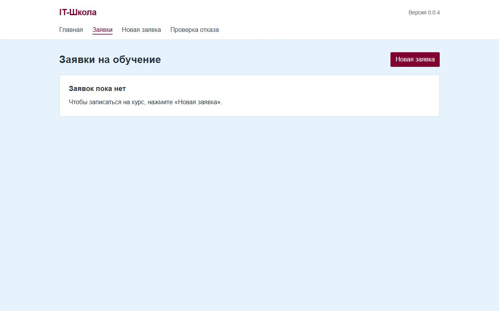
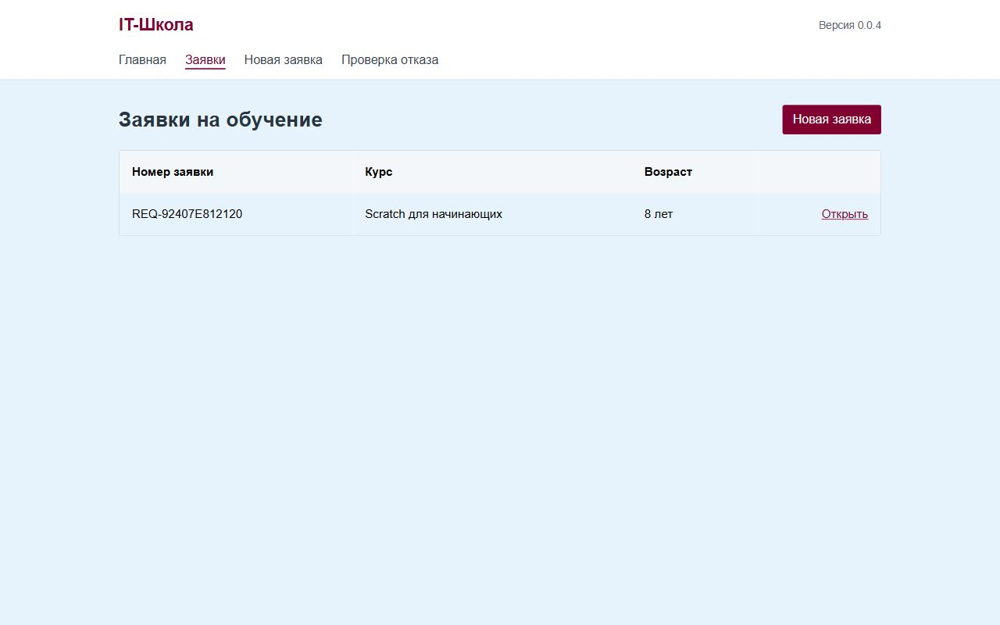
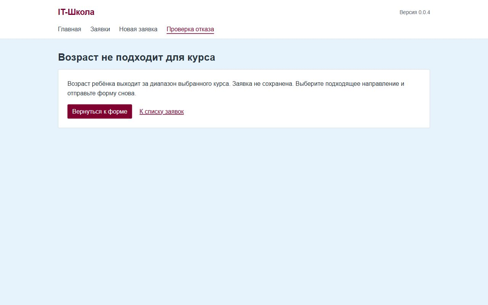

# Отчёт по лабораторной работе №4

Интерфейс и внешний вид рабочей версии

Информационная система «IT-Школа», версия 0.0.4

Выполнила: Апахова Ксения, ИСТбд-41. Проверил: Баженов Д. В.

Ульяновск, 2026

## Введение

Работа продолжает лабораторные 1–3 для детской IT-школы. Оформлены прежние функции: создание заявки родителем, просмотр сохранённых заявок и отказ при нарушении условий. Данные курсов и заявок остаются в PostgreSQL 18.

## Выбор интерфейса

| Кто работает с данными | Кто клиент | Где живёт интерфейс версии | Чем собран вид | Что отложено |
| --- | --- | --- | --- | --- |
| Сотрудник детской IT-школы просматривает заявки; родитель вводит сведения | Родитель ребёнка | Общие страницы внутри Django-приложения, сервис `app` | Django Templates, локальный Bootstrap 5.3.8 и собственный CSS | Отдельный кабинет сотрудника, учётные записи и мобильное приложение |

Рассмотрены общий интерфейс в существующем приложении, отдельная административная панель и отдельный клиентский фронтенд. Выбран первый вариант: для трёх функций достаточно серверных страниц, уже принятых в работе №2. Второй сервис с React или Vue не требуется. Платформа Python 3.11 / Django 4.2.16 из работы №1 и PostgreSQL 18 из работы №3 сохранены.

Вместо служебных страниц работ 1–3 собран общий адаптивный макет: меню, таблица курсов, форма, состояния списка и экран отказа. Отдельные макеты третьего курса в эту версию не переносились: новый макет объединяет пять уже реализованных экранов и позволяет пройти три сценария без ручного ввода адресов. Предметная область остаётся прежней — детская IT-школа.

## Библиотеки

| Средство | Версия | Назначение |
| --- | --- | --- |
| Python | 3.11 | Язык и базовый Docker-образ |
| Django и Django Templates | 4.2.16 | Маршруты, формы, серверная сборка HTML, ORM, миграции |
| Bootstrap | 5.3.8 | Сетка, кнопки, формы, таблицы и адаптивные отступы |
| Собственный CSS | 0.0.4 | Голубой фон, бургунди-акценты, композиция экранов |
| WhiteNoise | 6.12.0 | Выдача CSS из образа при `DEBUG=False` |
| Gunicorn | 22.0.0 | Сервер приложения, порт 8080 |
| psycopg2-binary | 2.9.9 | Подключение к PostgreSQL |
| dj-database-url | 2.1.0 | Настройка подключения из `DATABASE_URL` |
| PostgreSQL | 18 | Постоянное хранение курсов и заявок |

Bootstrap и его лицензия находятся в `core/static/core/vendor/`. Страницы не используют CDN, внешние шрифты или JavaScript. В образе CSS собирается командой `collectstatic`.

## Docker Compose

```yaml
name: mispisit-apahova

services:
  app:
    image: ksushkaap/mispisit-lab1:0.0.4
    ports:
      - "8080:8080"
    environment:
      DATABASE_URL: postgres://app:app@db:5432/app
    depends_on:
      db:
        condition: service_healthy
  db:
    image: postgres:18
    environment:
      POSTGRES_USER: app
      POSTGRES_PASSWORD: app
      POSTGRES_DB: app
      PGDATA: /var/lib/postgresql/data/pgdata
    volumes:
      - dbdata:/var/lib/postgresql/data
    healthcheck:
      test: ["CMD-SHELL", "pg_isready -U app -d app"]
      interval: 5s
      timeout: 5s
      retries: 5


volumes:
  dbdata:
```

Сохраняются таблицы core_course и core_studentrequest, имя проекта mispisit-apahova и том dbdata. Новая миграция добавляет курсы только при полностью пустом справочнике. Существующие данные не переписываются.

## Создание и просмотр заявки

На отдельной учебной базе сначала открыт пустой список.



Рисунок 1 — Пустой список заявок.

Через форму подана заявка: Анна Смирнова, 8 лет, курс «Scratch для начинающих». После сохранения номер REQ-92407E812120 появился в карточке и в том же списке. Запись сохранилась после пересоздания контейнера приложения.



Рисунок 2 — Тот же список после подачи заявки.

## Ошибочный сценарий

При повторной подаче для Scratch (7–9 лет) указан возраст 12 лет. Сервер перенаправил на отдельную страницу отказа HTTP 422. Число заявок не увеличилось. В карточке также доступна учебная проверка телефона: несовпадение с сохранённым даёт HTTP 403. Полноценный вход в учётные записи отложен.



Рисунок 3 — Отказ при неподходящем возрасте ребёнка.

## Проверки

На отдельной базе PostgreSQL 18 выполнены 9 функциональных тестов Django: создание и чтение записи, границы возраста, отказ вне диапазона, несовпадение телефона, валидация полей, сохранность прежней записи, отсутствие заявки, CSRF и навигация. Команда для повторения на отдельной учебной базе: `python manage.py test core`.

В браузере проверены широкий экран и мобильная ширина 390 px; горизонтального переполнения главной и формы нет. Созданная через форму заявка осталась в списке после пересоздания контейнера приложения. Скриншоты лежат в `docs/screenshots/`. Сборка проверена локально для `linux/amd64`; сборка и публикация `linux/arm64` выполняются автором перед сдачей.

## Запуск

Блок для преподавателя используется после самостоятельной публикации обновлённого образа и ветки `lab4`.

Репозиторий: https://github.com/ksushka2/APAHOVA_MispisitLabs

Ветка: lab4

Образ: ksushkaap/mispisit-lab1:0.0.4

```bash
git clone -b lab4 https://github.com/ksushka2/APAHOVA_MispisitLabs
cd APAHOVA_MispisitLabs
docker compose up -d
```

Адрес: [http://localhost:8080](http://localhost:8080).

После создания или обновления Pull Request добавьте его фактическую ссылку в этот раздел и в отчёт. Существование и номер PR не предполагаются по номеру лабораторной работы.

## Вывод

Пять страниц IT-школы оформлены в едином стиле: светло-голубой фон, бургунди-акценты, локальный Bootstrap и общее меню. Создание, просмотр заявки и логический отказ работают с PostgreSQL. Публикация исходников и образа выполняется автором самостоятельно.

## Подготовка DOCX к сдаче

Перенесите материалы в DOCX объёмом 3–5 страниц, сохранив титульный лист с названием системы, две таблицы решения и библиотеки, текст Compose, три скриншота и блок запуска. После публикации добавьте фактическую ссылку на PR. Проверьте страницы в Word перед сдачей.
